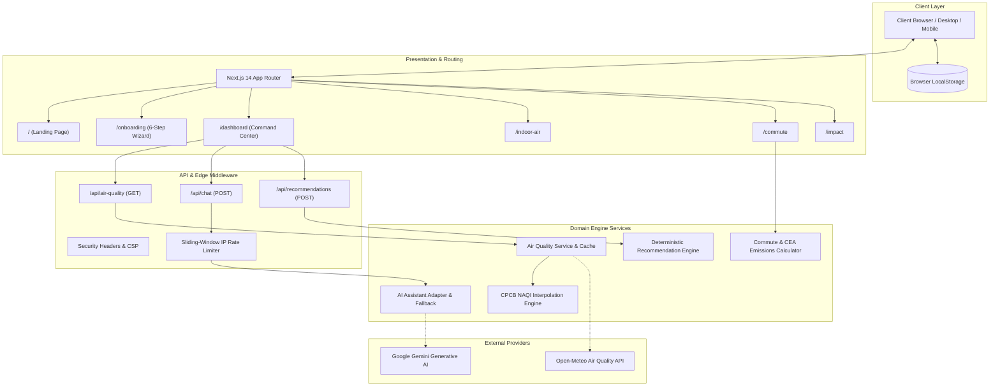

# System Architecture & Technical Specifications

## Architectural Characteristics
- **Framework:** Next.js 14 (App Router) with React Server & Client Components
- **Data Fetching:** Incremental Static Regeneration with 15-minute in-memory caching
- **Dynamic Bundling:** Dynamic imports for heavy SVG charting elements
- **Defensive Edge:** Rate limiting, CSP, X-Frame-Options, and origin validation
