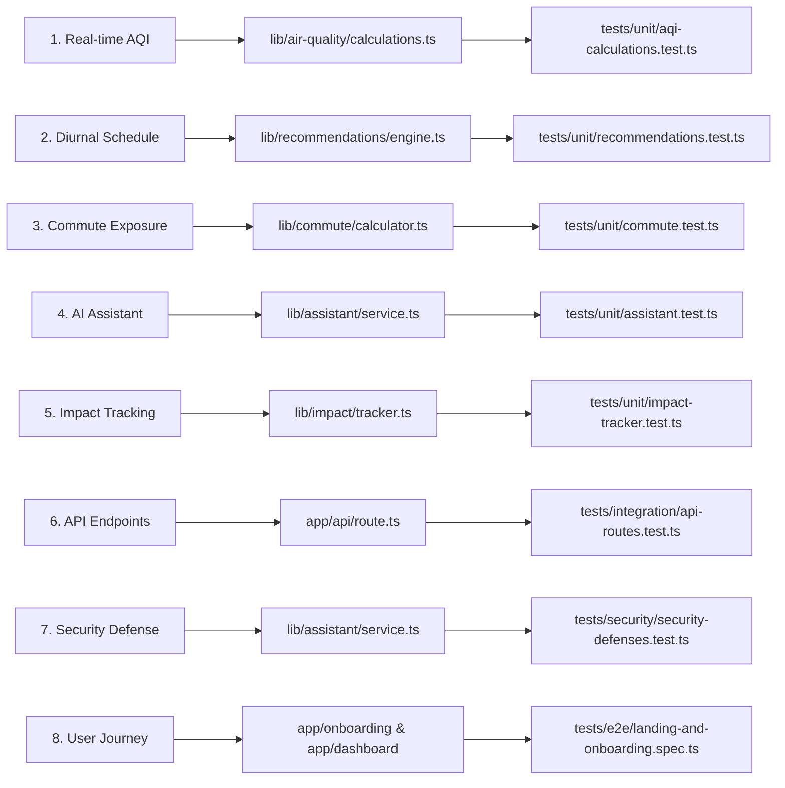

# Feature Traceability Matrix
### Detailed Requirement to Component to Test Mapping

### Traceability Breakdown

1. **Air Quality Calculations:**
   - Requirement: Compute CPCB NAQI compliant values.
   - Code: `lib/air-quality/calculations.ts` (lines 10-65)
   - Test: `tests/unit/aqi-calculations.test.ts` (lines 7-52)

2. **Personalized Health Logic:**
   - Requirement: Pediatric and senior citizen prioritization.
   - Code: `lib/recommendations/engine.ts` (lines 75-105)
   - Test: `tests/unit/recommendations.test.ts` (lines 32-41)

3. **Commute Comparison:**
   - Requirement: Active transit warning when AQI > 200.
   - Code: `lib/commute/calculator.ts` (lines 60-78)
   - Test: `tests/unit/commute.test.ts` (lines 31-40)

4. **AI Generative Assistant:**
   - Requirement: Prompt injection defense & structured non-medical advice.
   - Code: `lib/assistant/service.ts` (lines 10-120)
   - Test: `tests/unit/assistant.test.ts` (lines 8-50)

5. **Impact Methodology:**
   - Requirement: CEA emissions factor calculation.
   - Code: `lib/impact/tracker.ts` (lines 45-80)
   - Test: `tests/unit/impact-tracker.test.ts` (lines 14-35)
