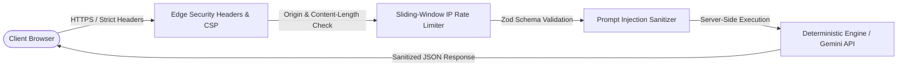

# Security Architecture & Policies — BreatheWise AI

## 1. Security Architecture Overview
BreatheWise AI implements defense-in-depth security principles across transport, application logic, data handling, and AI interaction.

---

## 2. Core Defensive Controls

### A. Zero Client-Side Secret Leakage
- `GEMINI_API_KEY` is kept exclusively on the server runtime.
- No secrets are prefixed with `NEXT_PUBLIC_`.
- Environment variable `.env.example` contains only template definitions with empty values.

### B. Input Validation & Boundaries
- All client request bodies and query parameters are validated at the network entry point using `zod` schemas (`lib/types/validation.ts`):
  - `ChatRequestSchema`: Bounds queries to max 500 characters and validates nested household context.
  - `AirQualityQuerySchema`: Restricts city string lengths and clamps latitude (-90 to +90) and longitude (-180 to +180).
  - `RecommendationsRequestSchema`: Enforces bounds on numeric AQI and particulate inputs.

### C. Rate Limiting & DoS Protection
- Expensive AI inference endpoints (`/api/chat`) enforce sliding-window IP rate limiting:
  - Threshold: 20 requests per minute per IP.
  - HTTP 429 "Too Many Requests" returned upon saturation.
  - Request body length limit: Max 25 KB.

### D. Prompt Injection & Adversarial Defense
- User inputs pass through `sanitizeUserInput` (`lib/assistant/service.ts`) before model generation.
- Common jailbreak patterns (`"ignore previous instructions"`, `"developer mode"`, `"system prompt override"`, `"roleplay as"`) are neutralized and logged.

### E. Hardened HTTP Headers
Configured via `next.config.mjs`:
- `Content-Security-Policy`: Restricts scripts, styles, fonts, and API connections.
- `X-Frame-Options: DENY`: Prevents UI redressing and clickjacking attacks.
- `X-Content-Type-Options: nosniff`: Defends against MIME confusion.
- `Referrer-Policy: strict-origin-when-cross-origin`: Minimizes referrer leakage.
- `Permissions-Policy`: Disables unused device APIs (camera, microphone).

---

## 3. Vulnerability Reporting
To report security concerns, contact `security@breathewise.ai`. Reports will be acknowledged within 24 hours.
