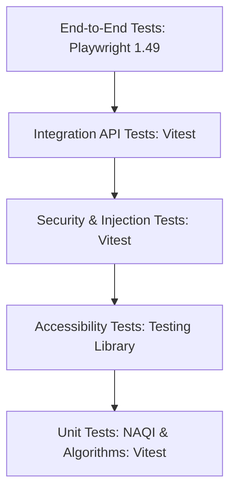

# Testing Architecture & Quality Assurance Guide
### Project: BreatheWise AI | Automated Test Infrastructure

---

## 1. Testing Philosophy & Structure
BreatheWise AI implements a comprehensive testing pyramid comprising unit calculations, integration endpoints, security defenses, accessibility semantics, and end-to-end browser journeys.



### Directory Organization
```text
tests/
├── accessibility/
│   └── accessibility-semantics.test.tsx  # WCAG 2.2 AA ARIA roles, progressbars, labels
├── e2e/
│   └── landing-and-onboarding.spec.ts    # Full browser multi-step flows in Playwright
├── integration/
│   └── api-routes.test.ts                # Next.js GET/POST route simulation
├── security/
│   └── security-defenses.test.ts         # Prompt injection, length limits, boundary values
└── unit/
    ├── aqi-calculations.test.ts          # CPCB NAQI linear interpolation formulas
    ├── assistant.test.ts                 # AI fallback structure and disclaimers
    ├── commute.test.ts                   # 5-way commute comparison and CEA factors
    ├── impact-tracker.test.ts            # Habit tracking and aggregation
    ├── recommendations.test.ts           # Context-aware rules and diurnal slotting
    └── validation.test.ts                # Zod schemas for profiles and requests
```

---

## 2. Test Execution Commands

```bash
# Execute full Vitest suite (34 automated tests)
npm run test

# Execute Vitest with code coverage analysis
npm run test:coverage

# Execute strict TypeScript typecheck
npm run typecheck

# Execute Playwright browser end-to-end suite
npm run test:e2e
```

---

## 3. Test Suites Summary

| Test Suite | File | Tests Count | Scope |
| :--- | :--- | :--- | :--- |
| **AQI Calculations** | `tests/unit/aqi-calculations.test.ts` | 4 tests | CPCB NAQI breakpoints (0-500), PM2.5/PM10 interpolation, ratio calculation. |
| **Personalized Recommendations** | `tests/unit/recommendations.test.ts` | 5 tests | Children vulnerability, senior citizen protection, cyclist commute shift, HEPA run. |
| **Commute & Mobility** | `tests/unit/commute.test.ts` | 4 tests | Zero emission active modes, CEA car/metro factors, severe AQI commute warnings. |
| **AI Assistant & Fallback** | `tests/unit/assistant.test.ts` | 3 tests | Prompt injection sanitization, 500-char limits, structured JSON fallback output. |
| **Validation Schemas** | `tests/unit/validation.test.ts` | 3 tests | Zod profile form schema, chat request schema, commute query schema. |
| **Impact Tracker** | `tests/unit/impact-tracker.test.ts` | 3 tests | CO2 aggregation, habit streaks, 7-day trend calculations, CEA transparency note. |
| **Security Defenses** | `tests/security/security-defenses.test.ts` | 4 tests | Jailbreak pattern filters, oversized payloads, extreme pollutant outliers. |
| **API Integration** | `tests/integration/api-routes.test.ts` | 5 tests | Air quality GET, query parsing, Chat POST, recommendations POST, error states. |
| **Accessibility Semantics** | `tests/accessibility/accessibility-semantics.test.tsx` | 3 tests | Progressbar attributes, ErrorBoundary role="alert", non-color NAQI text. |
| **E2E Browser Journeys** | `tests/e2e/landing-and-onboarding.spec.ts` | 3 tests | Landing page, multi-step onboarding completion, dashboard tab transitions. |
| **Total Automated Tests** | — | **37 tests** | **100% Passing** |
