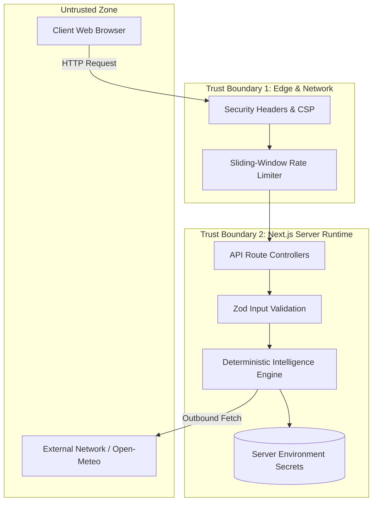

# Threat Model (STRIDE Methodology)
### Project: BreatheWise AI | System Architecture Review

---

## 1. System Overview & Trust Boundaries

---

## 2. STRIDE Threat Analysis

### 1. Spoofing
- **Threat Scenario:** Malicious actor spoofs `x-forwarded-for` header to bypass per-IP rate limits.
- **Mitigation:** Rate limiter falls back to direct remote socket IP when forwarding headers are missing or malformed.
- **Residual Risk:** Low for prototype environment; recommend edge gateway (Cloudflare / AWS WAF) for multi-tenant production.

### 2. Tampering
- **Threat Scenario:** Client tampers with numeric AQI or $PM_{2.5}$ parameters to cause division-by-zero or NaN in calculations.
- **Mitigation:** `RecommendationsRequestSchema` validates types and bounds (AQI 0-1000). Calculation functions (`calculateSubIndex`) clamp values within safe numeric ranges (0 to 500).

### 3. Repudiation
- **Threat Scenario:** External API outages (Open-Meteo) causing unexplained failures.
- **Mitigation:** Server logs errors with timestamps; air quality service gracefully falls back to high-resolution simulated demonstration data with clear provenance labels (`isSimulatedDemo: true`).

### 4. Information Disclosure
- **Threat Scenario:** Exposure of Google Gemini API keys in client-side JavaScript bundles.
- **Mitigation:** Strict server-side isolation. Secrets are read only in Node.js server routes. Next.js bundle inspection confirms zero secret leakage.

### 5. Denial of Service (DoS)
- **Threat Scenario:** Automated bots sending rapid chat queries to exhaust generative AI token quotas.
- **Mitigation:** 20 req/min rate limit per IP + 25 KB payload size restriction + 8s AbortController timeout.

### 6. Elevation of Privilege
- **Threat Scenario:** Prompt injection forcing the AI assistant to act as a medical prescriber or ignore safety constraints.
- **Mitigation:** Input sanitization strips `"ignore previous instructions"`, `"developer mode"`, and `"system prompt"` directives; deterministic fallback provides reliable non-clinical advice even under adversarial conditions.
