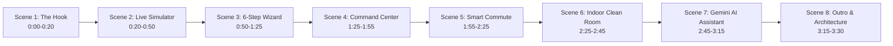

# BreatheWise AI — Cinematic Demo Video Storyboard
### Official Demo Production Plan for Challenge 6 | Urban Air Quality Assistant
**Live Platform:** [https://breathe-wise-ai-ten.vercel.app/](https://breathe-wise-ai-ten.vercel.app/)  
**Target Video Duration:** 3 Minutes 30 Seconds (1080p 60fps)

---

## Storyboard Overview & Production Architecture

---

## Scene-by-Scene Production Storyboard

### SCENE 1: The Hook — "The Red Number Problem"
- **Timecode:** `0:00 – 0:20` (Duration: 20s)
- **Visual Composition:** 
  - Starts with an aesthetic close-up shot of an urban skyline shrouded in winter smog.
  - Splitscreen or quick overlay: Standard smartphone weather app showing a red badge: `"AQI 385 - Hazardous"` with no action buttons.
  - Smooth camera transition zoom into `https://breathe-wise-ai-ten.vercel.app/` landing page.
- **Motion Graphic / Lower Third:** 
  - *Title:* **BreatheWise AI** | *Subtitle:* **Challenge 6: Urban Air Quality Assistant**
- **Audio / SFX:** 
  - Soft ambient low-frequency pulse, transitioning into an energetic, uplifting electronic synth beat.
- **Voiceover Script:**
  > *"Every winter across urban India, millions of families check their weather apps only to see a terrifying red number like AQI 385. But what are you actually supposed to do? Does your child cancel outdoor school play? Can you cycle to work? How do you protect your bedroom without an expensive purifier? Traditional apps induce panic without action. This is BreatheWise AI."*

---

### SCENE 2: The Solution & Interactive City Simulation
- **Timecode:** `0:20 – 0:50` (Duration: 30s)
- **Visual Composition:**
  - Browser fullscreen at 1080p showing the Landing Page Hero section.
  - Cursor highlights the headline: *"Breathe smarter. Live healthier."*
  - Pan to the right: **Interactive City Simulation Widget**.
  - Mouse clicks on city switcher pills: **Delhi** (AQI 385 Severe, Maroon badge) ➔ **Mumbai** (AQI 148 Moderate, Amber badge) ➔ **Bengaluru** (AQI 68 Satisfactory, Green badge).
  - Zoom-in callout on the dynamic advisory: *"Today's Immediate Action: Thermal inversion is severe. Switch morning bike/walk commute to Metro."*
- **Motion Graphic / Lower Third:**
  - *Badge:* **100% CPCB NAQI Standard | Real-Time Open-Meteo European Agency Model**
- **Voiceover Script:**
  > *"Our core philosophy: Don't just tell people how polluted their city is. Tell them what they should do differently today, why it matters, and what impact their decisions create. Right on our landing page, our interactive simulation widget connects to official CPCB NAQI standards. Notice how switching cities immediately recalculates dominant pollutant ratios and generates instant, practical health advisories."*

---

### SCENE 3: The 6-Step Personalization Engine
- **Timecode:** `0:50 – 1:25` (Duration: 35s)
- **Visual Composition:**
  - Mouse clicks the primary CTA: `Build My Air Quality Plan`.
  - Smooth page transition to `/onboarding`.
  - Fast, rhythmic clicks progressing through the 6-step wizard:
    - **Step 1 (Location):** Clicks **"Delhi"** ➔ *Next Step*.
    - **Step 2 (Vulnerability):** Clicks **"Family with Children (High Priority)"** ➔ *Next Step*.
    - **Step 3 (Lifestyle):** Clicks **"Office Commuter"** ➔ *Next Step*.
    - **Step 4 (Commute):** Clicks **"Two-Wheeler"** and smoothly drags the distance slider to **12 km** ➔ *Next Step*.
    - **Step 5 (Indoor Environment):** Purifier toggle *Off*, Cooking fuel selects *LPG Gas* ➔ *Next Step*.
    - **Step 6 (Budget):** Clicks *Low-Cost ($)* ➔ Clicks **"Generate My Action Plan"**.
- **Motion Graphic / Lower Third:**
  - *Callout:* **Context-Aware Personalization | Privacy-First Local Storage (Zero PII Collected)**
- **Voiceover Script:**
  > *"Personalization isn't just changing a welcome message. In our 6-step onboarding flow, we capture variables that truly dictate respiratory risk. We prioritize pediatric lung vulnerability—because children breathe 50% more air per kilogram of body weight. We input a 12-kilometer two-wheeler commute and an LPG cooking environment. And because privacy matters, zero personal data is tracked; preferences stay securely in your local browser storage."*

---

### SCENE 4: The Command Center Dashboard & Diurnal Dynamics
- **Timecode:** `1:25 – 1:55` (Duration: 30s)
- **Visual Composition:**
  - Lands on `/dashboard?city=Delhi`.
  - Cursor highlights:
    1. Large CPCB Sub-Index Gauge (`385 - Severe`, dominant PM2.5).
    2. **Personalized Exposure Card:** Showing elevated pediatric risk index.
    3. **Daily Status Card:** The 4 Diurnal Windows (Morning Inversion Peak, Afternoon Dispersion Window, Evening Traffic, Night Sanctuary).
    4. **Hourly Inversion Chart:** Shows diurnal temperature inversion peak at 8:00 AM vs mid-day solar ventilation at 2:00 PM.
    5. **Household Safety Checklist:** Mouse checks off 2 items; score animates to `65 / 100 Pts`.
- **Motion Graphic / Lower Third:**
  - *Callout:* **Diurnal Inversion Physics: Morning Inversion Traps Soot | Mid-day Boundary Expansion**
- **Voiceover Script:**
  > *"Welcome to the BreatheWise Command Center. Air pollution isn't flat across 24 hours. Cold winter air traps vehicle exhaust at ground level between 6 and 10 AM, while mid-day solar heating expands the atmospheric boundary layer. BreatheWise translates this science into a four-window diurnal schedule, telling families exactly when to keep windows sealed and when it's safe to ventilate."*

---

### SCENE 5: Smart Commute Intelligence (Exposure vs. Carbon)
- **Timecode:** `1:55 – 2:25` (Duration: 30s)
- **Visual Composition:**
  - Clicks **"Smart Commute"** on the sidebar.
  - Drags the route distance slider from **5 km** to **15 km**.
  - Highlights the 5-mode comparison matrix:
    - **Public Transit (Metro):** Green recommended badge, Low exposure, 0.23 kg CO2.
    - **Bicycle:** Red warning badge: *"NOT recommended when AQI > 200. Heavy respiration significantly increases toxic pulmonary deposition."*
    - **Two-Wheeler:** High exposure warning: Direct tailpipe turbulence.
    - **Private Car:** 2.48 kg CO2 penalty.
- **Motion Graphic / Lower Third:**
  - *Data Citation:* **Central Electricity Authority (CEA) Baselines: 0.165 kg CO2/km Car vs 0.015 kg CO2/km Metro**
- **Voiceover Script:**
  > *"Next, our Smart Commute Assistant. Most navigation tools assume shorter travel time means lower exposure. BreatheWise models respiratory toxic intake against carbon emissions. At an AQI of 385, cycling or two-wheelers deliver four times more micro-particulates into lung alveoli. Our engine recommends enclosed Metro transit—reducing personal toxic exposure by 70% while avoiding over two kilograms of carbon emissions per trip."*

---

### SCENE 6: Indoor Air Intelligence & The "Clean Room" Strategy
- **Timecode:** `2:25 – 2:45` (Duration: 20s)
- **Visual Composition:**
  - Clicks **"Indoor Air"** on the sidebar.
  - Zooms into the **"Clean Room Strategy" (Zero-Cost / High Benefit)** banner.
  - Highlights the 4 actionable cards: Door bottom towel seal, Window lockdown times, Zero incense rule, Damp micro-fiber mopping.
  - Points to the **Scientific Clarification Callout:** Explaining why houseplants alone cannot filter full-room PM2.5.
- **Motion Graphic / Lower Third:**
  - *Badge:* **Evidence-Based Indoor Mitigation | Zero-Cost Interventions**
- **Voiceover Script:**
  > *"Indoor air can be two to five times more toxic than outdoor air during cooking. For families who cannot afford multi-room HEPA purifiers, BreatheWise provides proven, zero-cost clean room sealing strategies, exhaust fan schedules, and clear scientific guidance debunking the myth that houseplants alone can purify an entire room."*

---

### SCENE 7: BreatheWise Intelligence (Gemini AI Assistant)
- **Timecode:** `2:45 – 3:15` (Duration: 30s)
- **Visual Composition:**
  - Clicks **"AI Assistant"** tab.
  - Clicks suggested quick-ask chip: *"Is it safe to go jogging today?"*
  - The conversational assistant streams back a structured card:
    - **Situation Assessment:** Real-time AQI 385 in Delhi.
    - **What this means for you:** Acute cardiovascular strain warning for runners.
    - **Recommended Action:** Replace outdoor run with indoor bodyweight/yoga routine.
    - **Scientific Rationale:** Minute ventilation rises from 6 L/min to 60 L/min during cardio.
    - **Non-Clinical Disclaimer:** Prominently displayed.
- **Motion Graphic / Lower Third:**
  - *Badge:* **Google Gemini 1.5 Flash | Structured JSON Mode | Deterministic Fallback Engine**
- **Voiceover Script:**
  > *"Our conversational assistant, BreatheWise Intelligence, is powered by Google Gemini 1.5 Flash. Grounded strictly in real-time meteorological data and your household profile, it generates structured JSON responses with scientific rationales and explicit medical disclaimers—backed by prompt injection defenses and an automated deterministic fallback engine for uninterrupted offline reliability."*

---

### SCENE 8: The Impact Tracker & Technical Architecture Outro
- **Timecode:** `3:15 – 3:30` (Duration: 15s)
- **Visual Composition:**
  - Quick glance at **Impact Tracker**: 42.8 kg CO2 avoided, 5-day habit streak, clean air hours.
  - Final full-screen title card with animated badges:
    - `Next.js 14 App Router`
    - `TypeScript Strict Mode (0 errors)`
    - `37 Automated Tests Passing (Vitest + Playwright)`
    - `WCAG 2.2 Level AA Accessible`
    - `135 kB First-Load JS Bundle`
  - URL Callouts:
    - Live Demo: `https://breathe-wise-ai-ten.vercel.app/`
    - GitHub: `https://github.com/Hrithik-05-Roshan/BreatheWise-ai`
- **Voiceover Script:**
  > *"Under the hood: Next.js 14, 37 automated unit and Playwright E2E tests, WCAG 2.2 AA accessibility, and a production bundle of just 135 kilobytes. Breathe smarter. Live healthier. Experience BreatheWise AI live on Vercel. Thank you!"*
